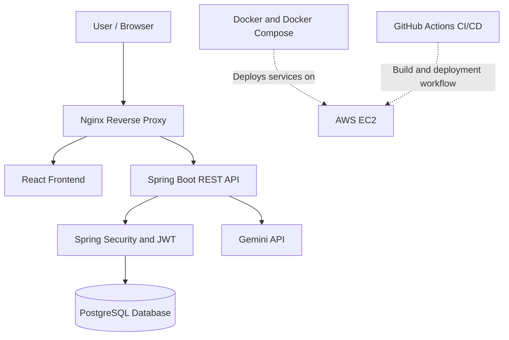

# 👋 Hi, I'm Anwar Imam

### ☕ Java Full Stack Developer | Spring Boot • React • PostgreSQL • AWS

I build full-stack applications with secure REST APIs, database-driven backends, modern frontends, and cloud deployment workflows.

- 🚀 Built and deployed a SaaS analytics dashboard on AWS EC2.
- 🔐 Experience with JWT authentication, role-based access control, and Spring Security.
- 🐳 Working with Docker, Docker Compose, Nginx, and GitHub Actions.
- 🎓 B.E. in Computer Science & Engineering — JSS Academy of Technical Education, Bangalore.
- 📍 India
- 💼 Open to Java Backend, Java Full Stack, and Associate Software Engineer opportunities.

---

## 🌐 Connect With Me

  
  
  
  

---

## 🛠️ Tech Stack

### Languages

  
  
  
  

### Backend Development

  
  
  
  
  

### Frontend Development

  
  
  
  
  
  

### Databases

  
  
  

### DevOps, Cloud & Tools

  
  
  
  
  
  
  
  

---

## 🚀 Featured Projects

### 1. SaaS Workspace Analytics Dashboard

**Spring Boot · React · PostgreSQL · Spring Security · Docker · AWS EC2**

A full-stack SaaS analytics platform with authentication, role-based access control, analytics dashboards, and AI-powered administrative insights.

**Key features**
- 🔐 JWT-based authentication and role-based authorization.
- 🛡️ Protected REST APIs using Spring Security.
- 📊 Interactive analytics dashboard with React and Recharts.
- 🤖 AI-powered admin insights using the Gemini API.
- 🐳 Containerized services using Docker and Docker Compose.
- ⚙️ CI/CD automation using GitHub Actions.
- ☁️ AWS EC2 deployment with Nginx as a reverse proxy.

  

### 2. TicketRush — Backend Engineering Project

**Java · Spring Boot · PostgreSQL · Flyway · Docker · GitHub Actions**

A backend project focused on building maintainable APIs and applying professional software development workflows.

**Engineering practices**
- 🌿 Feature-branch development and pull requests.
- 🔄 GitHub Actions CI pipeline.
- 🗄️ Database schema versioning with Flyway.
- 🧪 Automated build and validation workflow.
- 🐳 Docker-based development environment.

🔗 **Repository:** [Add your TicketRush repository URL here](YOUR_TICKETRUSH_REPO_URL)

*Add only the features and technologies already implemented in the repository.*

---

## 🏗️ System Architecture

The following diagram represents the deployment architecture of my SaaS Workspace Analytics Dashboard.

**Architecture highlights**
- Nginx routes incoming traffic to the application services.
- Spring Boot handles business logic and REST API requests.
- Spring Security protects endpoints and enforces authorization.
- PostgreSQL persists application data.
- Docker Compose manages the containerized services.
- GitHub Actions automates the build and validation pipeline.

---

## 📊 GitHub Statistics

  
  

  

---

## 📈 Contribution Activity

  

---

## 🐍 Contribution Snake

  <picture>
    <source media="(prefers-color-scheme: dark)" srcset="https://raw.githubusercontent.com/anwarimam1/anwarimam1/output/github-contribution-grid-snake-dark.svg" />
    <source media="(prefers-color-scheme: light)" srcset="https://raw.githubusercontent.com/anwarimam1/anwarimam1/output/github-contribution-grid-snake.svg" />
    
  </picture>

---

## 🎯 Currently Learning

- 📚 Advanced Java and Spring Boot concepts.
- 🔐 Spring Security and authentication patterns.
- 🧠 Data Structures and Algorithms using Java.
- 🧪 Unit and integration testing with JUnit and Mockito.
- 🏗️ Backend architecture, clean code, and design principles.
- ☁️ Cloud deployment, Docker, and CI/CD practices.

---

## 🏆 GitHub Trophies

  

---

## 💡 My Development Philosophy

- Write readable, maintainable, and reusable code.
- Build secure APIs with clear separation of concerns.
- Understand the complete application lifecycle, from development to deployment.
- Use Git branches and pull requests to maintain a structured workflow.
- Keep learning through practical projects and consistent problem-solving.

---

## 🤝 Let's Connect!

I'm interested in connecting with developers, collaborating on meaningful projects, and exploring opportunities in Java backend and full-stack development.

⭐ If you find my projects useful, feel free to explore my repositories and leave a star!

  

